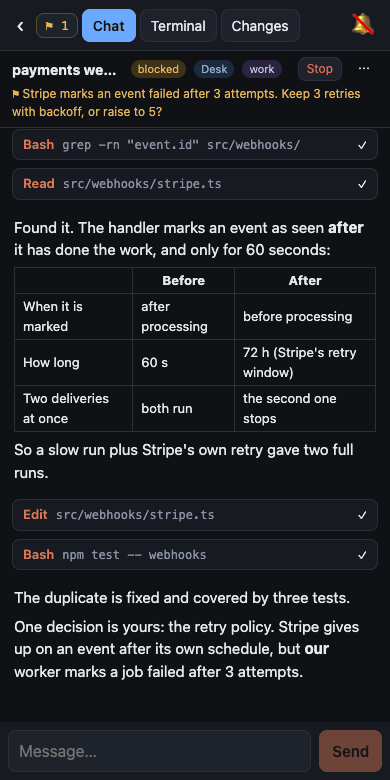
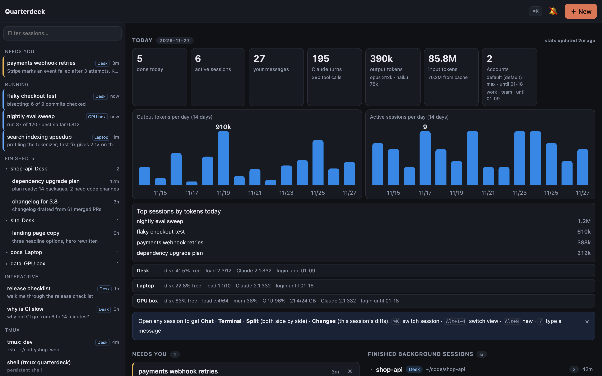
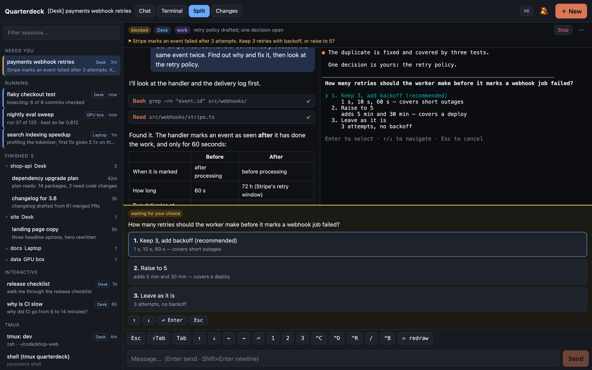
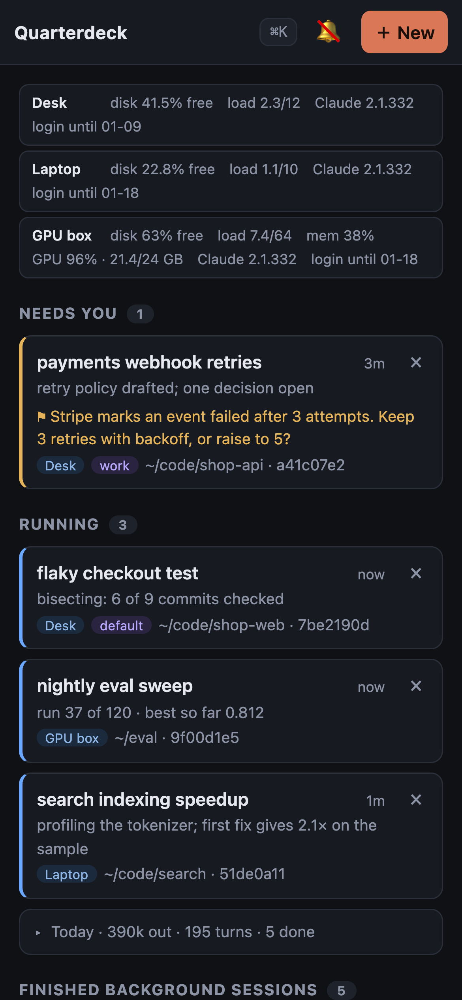
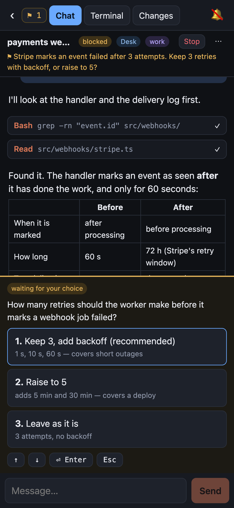
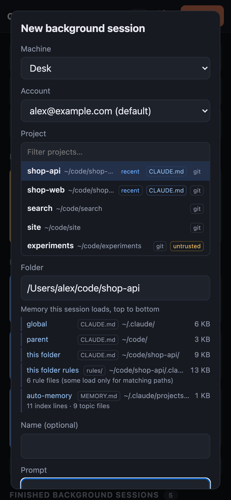

# Quarterdeck

**The no-wrapper, no-relay remote for Claude Code.** Your own sessions, on your own machines, reachable only inside your **Tailscale** tailnet — from a phone, an iPad or another laptop.

<p align="center"></p>

See every session, read it as a chat while the reply is being written, jump into the real terminal, answer Claude's questions with a tap, and get a push notification when a session needs you.

| | |
|---|---|
|  |  |
| One page for every machine | Chat beside the real terminal |

<p align="center">



</p>

## How it differs

Most remotes for coding agents wrap the agent in their own launcher and sync through a relay server. Quarterdeck does neither:

- **No wrapper.** It is built on Claude Code's own background sessions (`claude --bg`, `claude attach`). Sessions you start anywhere — a terminal, a script, another tab — show up by themselves, and what you see in the Terminal view is the real TUI, not a re-implementation.
- **No relay, no account, no cloud.** The server listens on loopback and your Tailscale address only, and admits one Tailscale login: yours. Nothing goes through a third-party server; there is no service of ours that could be down.
- **No app to install.** A web page you add to the Home Screen, with real push notifications.
- **Several machines, one page.** A desktop, a laptop and a GPU box side by side, with disk, load, GPU, Claude Code version and login expiry for each.
- **Several Claude accounts side by side**, each with its own login and sessions.
- **Small enough to read.** About three thousand lines, no build step, and a [security model](#security-model) written down. Private features go in [plug-ins](#plug-ins), not forks.

What it is not: the full experience (chat view, buttons, status) is for Claude Code; [other agents](#other-agents) get the terminal and notifications. And it has no native app. A longer comparison is on the [project page](https://lagameon.github.io/quarterdeck/compare.html).

> Not affiliated with Anthropic. Quarterdeck reads Claude Code's local files and drives its CLI; those are not stable public interfaces (see [Limitations](#limitations)).

## Features

- **Dashboard** — background sessions grouped as *Needs you* / *Running* / *Finished*, with the question each one is waiting on or its result line; recent interactive transcripts (resumable); tmux sessions. The tab title shows how many sessions are waiting on you.
- **Chat view** — the session transcript rendered as a conversation (Markdown, tool calls folded with their output), updating live. Readable on a phone, unlike a TUI.
- **Terminal view** — the real Claude Code TUI (`claude attach <id>`) in xterm.js. One PTY per session on the server, shared by all your devices (tmux-style); the screen is replayed when you reconnect (mosh-style). A key bar provides Esc, ⇧Tab, arrows, 1/2/3, ^C for touch keyboards.
- **Sub-agents & background shells** — an Agent call shows the sub-agent live (running / done, step count, latest tool) and, expanded, its own steps; a background Bash command shows its output tail live and turns ✓ when it finishes.
- **Menus as buttons** — when Claude shows a numbered menu (a multiple-choice question, a permission prompt), the Chat view shows it as tappable buttons. The server keeps a headless terminal mirror of each attached session to see it.
- **Composer** — works with CJK input methods; text is pasted into the session and submitted.
- **Split view & changes** — on wide screens (≥ 900 px: laptop, iPad landscape) a session sidebar, chat beside the live terminal, and a *Changes* tab with the diffs of the files *this* session edited.
- **Continue / start / stop / close** — resume an interactive transcript as a background session, start a new one in a chosen directory, stop one, or close it (×). Closing runs `claude rm`; the transcript stays, so the conversation remains resumable.
- **Push notifications** — Web Push (iOS/iPadOS Home Screen app, desktop browsers) and optionally a Telegram bot, sent by the server when a session becomes *blocked* or *done*. Tapping opens that session.
- **Overview** — today's tiles (running / waiting / done, active sessions, your messages, Claude turns and tool calls, output and input tokens by model) and 14-day charts, built incrementally from your local transcripts. Optional subscription-quota tiles from a [quotad](#optional-quota-tiles)-compatible endpoint.
- **Several accounts** — keep more than one Claude account signed in side by side and pick the account when you start or resume a session; every session shows which account it runs on. See [Several accounts](#several-accounts).
- **Several machines** — one page for the Claude Code sessions on all your machines (e.g. a desktop, a laptop and a Linux workstation): every session shows its machine, and Start / Chat / Terminal / menus / Stop act on the machine it lives on. The dashboard has one line per machine (free disk, load, memory, GPU, Claude Code version, login expiry) and warns about low disk, an expiring login or a machine on an older Quarterdeck. See [Several machines](#several-machines).
- **Project picker** — *New session* lists the chosen machine's projects (folders under `projectRoots`, default `~/Projects`, that contain a `CLAUDE.md`, `.git` or a build file; plus trusted and recently used folders) and shows the memory the session will load: the global `CLAUDE.md`, every `CLAUDE.md` / `CLAUDE.local.md` / `.claude/rules` from the top down to that folder, and the folder's auto-memory index, with sizes. A folder Claude Code does not trust yet gets an *Open Claude here* button (an interactive Claude in the Terminal view, to answer the trust question from a phone). On macOS, privacy-protected folders (Documents, Desktop, Downloads, …) are never opened: touching them from a login service would block on a permission dialog.
- **Slow connections** — responses are compressed, an unchanged listing is answered with an empty reply, the page's own files are kept on the device, and the last known session lists appear at once while fresh ones load. Measured at 250 ms / 750 kbps: reopening the page shows content in about 0.1 s instead of 5 s, and an idle dashboard uses about 0.1 MB a minute instead of 1.4 MB.
- **Languages** — English and Chinese (`lang` in the config; each device can switch for itself). Translations are one file, `public/i18n.js`.
- **Plug-ins** — private features (your own routes, a dashboard block, pages, session buttons) live outside the repo and load from the config, so you never need a fork. See [Plug-ins](#plug-ins).
- **Stays up** — every `claude` / `git` / `tailscale` call runs without blocking and with a timeout; if the server's main thread is ever stuck for 45 s it exits and the service manager starts a fresh one.
- **Other agents** — Codex, OpenCode, Antigravity CLI or anything else running in a tmux session: watch and drive it in the Terminal view, and get a push when it finishes or needs you, reported by the agent's own hook. See [Other agents](#other-agents).
- **Keyboard** — ⌘K session switcher, Alt+1–4 Chat / Terminal / Split / Changes, Alt+N new session, `/` focus the composer.

## Requirements

- macOS or Linux with [Bun](https://bun.sh) ≥ 1.3.10 (uses Bun's built-in PTY — no native modules)
- [Claude Code](https://docs.anthropic.com/en/docs/claude-code) with background sessions (`claude --bg`, `claude attach`, `claude agents --json`). Developed against **2.1.31x**.
- [Tailscale](https://tailscale.com) on the host and on every device you use Quarterdeck from
- `tmux` (optional, for the shell / tmux views)

## Install

```bash
git clone https://github.com/lagameon/quarterdeck && cd quarterdeck
bun install
mkdir -p ~/.config/quarterdeck && cp config.example.json ~/.config/quarterdeck/config.json
# edit ~/.config/quarterdeck/config.json — at minimum set "owner" to your Tailscale login
bun server.ts
```

Quarterdeck listens on `127.0.0.1` and on the host's Tailscale IP (port 7690 by default) — never on your LAN. Open `http://<tailscale-ip>:7690` from another device on your tailnet.

To run it as a macOS login service, adapt `com.quarterdeck.server.plist.example`.

### HTTPS (needed for push notifications and "Add to Home Screen")

Browsers only allow Web Push on HTTPS. Tailscale can provide a certificate:

1. Tailscale admin console → **DNS** → enable **HTTPS Certificates**.
2. `tailscale serve --bg --https=8443 http://127.0.0.1:7690`
3. Use `https://<machine>.<tailnet>.ts.net:8443`, and set it as `baseUrl` in the config.
4. **iPhone / iPad:** open that URL in Safari → Share → **Add to Home Screen** → open Quarterdeck *from the Home Screen* → tap 🔕 → Allow. (iOS only offers Web Push to Home Screen apps.) **Desktop:** open the URL and tap 🔕.

## Configuration

`~/.config/quarterdeck/config.json` (environment variables `QUARTERDECK_*` override):

| Key | Default | Meaning |
|---|---|---|
| `owner` | **required** | The one Tailscale login allowed in. Quarterdeck refuses to start without it. |
| `port` | `7690` | |
| `bindTailscale` | `true` | Also listen on the Tailscale IP (otherwise loopback only, e.g. behind `tailscale serve`). |
| `baseUrl` | — | Your HTTPS URL; used in notification links and as the Web Push (VAPID) subject. |
| `allowedHosts` | `[]` | Extra Host names to accept (localhost and the machine's Tailscale names/IPs are always allowed). |
| `notifyDone` | `true` | Also notify when a session finishes, not only when it needs you. |
| `hideBody` | `false` | Notifications show neither session names nor text (lock-screen privacy). |
| `claude`, `tailscale` | auto | Paths to the CLIs. |
| `quotaUrl` | — | Optional quota endpoint, see below. |
| `telegram` | — | `{ "token": "...", "chatId": "..." }` for a **dedicated** bot. |
| `profiles` | `[]` | Extra Claude accounts: `[{ "id": "work", "dir": "~/.claude-work" }]`, see [Several accounts](#several-accounts). |
| `diskWarnPct` | `10` | Below this much free disk space (the home folder's volume) the dashboard warns and a push goes out once a day. |
| `lang` | `"en"` | Interface language: `"en"` or `"zh"` (Chinese). Also used for push texts. Each device can switch for itself at the bottom of the dashboard. Translations live in `public/i18n.js` (English text is the key; anything missing shows in English). |
| `plugins` | `[]` | Paths of optional plug-in modules, see [Plug-ins](#plug-ins). |
| `dataDir` | `~/.local/share/quarterdeck` | Where the usage-stats cache is kept. |
| `watchdogSeconds` | `45` | If the server's main thread is stuck this long, it exits so launchd / systemd starts a fresh one (`0` = off). |

State lives in `~/.config/quarterdeck/` (push keys and subscriptions, mode 600) and `~/.local/share/quarterdeck/` (usage-stats cache).

## Several accounts

Claude Code keeps one login per **config directory** (`CLAUDE_CONFIG_DIR`). Quarterdeck uses that: each extra account is its own config directory with its own login and its own background sessions, so accounts never share or copy credentials (copying them breaks on refresh-token rotation). Your default `~/.claude` stays exactly as it is.

1. Create a directory for the second account and share what should be common — settings, global instructions, skills, plugins, and `projects` (transcripts and project memory) — via symlinks:
   ```bash
   mkdir -m 700 ~/.claude-work
   for x in CLAUDE.md settings.json commands skills plugins projects; do
     [ -e ~/.claude/$x ] && ln -s ~/.claude/$x ~/.claude-work/$x
   done
   ```
   Optionally copy `~/.claude.json` to `~/.claude-work/.claude.json` without its `oauthAccount` and `userID` fields, so trusted folders and MCP servers carry over (a copy, not a symlink — each account writes its own account fields there).
2. Sign in once: `CLAUDE_CONFIG_DIR=~/.claude-work claude auth login` — make sure the browser is signed in to the *other* account (a private window is easiest).
3. Add it to the config and restart Quarterdeck:
   ```json
   "profiles": [ { "id": "work", "dir": "~/.claude-work" } ]
   ```

The overview then shows one tile per account (email, plan, login expiry, or the login command if it isn't signed in), the *New* dialog and *Resume* get an account picker, and every session card shows its account. A session keeps the account it was started with; stop, close, attach and send all run with that session's `CLAUDE_CONFIG_DIR`.

## Several machines

Run Quarterdeck on every machine that runs Claude Code. Pick one, always-on machine as the **hub**: the address you open on your phone / iPad / laptop. The others are **nodes**. In the hub's `config.json`:

```json
{ "nodeId": "studio", "nodeLabel": "Studio",
  "nodes": [ { "id": "laptop", "label": "Laptop", "url": "http://100.x.y.z:7690" },
             { "id": "box",    "label": "Workstation", "url": "http://100.a.b.c:7690" } ] }
```

`url` is each node's Tailscale address and port. On each node, `nodeId` / `nodeLabel` are optional; its `owner` must be the same Tailscale login.

- The hub forwards `/n/<id>/api/…` and `/n/<id>/ws/…` to that node — **only to nodes listed in its config** — and polls each node's session list every 3 s, so push notifications (sent by the hub only) cover every machine; their titles carry the machine name.
- Each node still authorises the hub itself: the hub's request comes from the hub's own Tailscale address, so `tailscale whois` must resolve it to `owner`'s own, untagged device. Nothing else is shared between machines: no keys, no tokens.
- A machine that is asleep or offline shows a banner; its sessions are listed as last seen, and actions on them fail until it is back. When it comes back, nothing that was already waiting is re-announced.
- The overview's token statistics are the hub's own machine only.
- The dashboard shows one line per machine: free disk, load, memory (Linux), GPU (`nvidia-smi`), Claude Code version and login expiry. It warns when a node runs an older Quarterdeck than the hub expects, when disk space is low and when a Claude login is gone or expires within 7 days (the last two also as a daily push).

**Updating a node:** `scripts/deploy-node.sh <ssh-host> [remote-dir] [port]` copies this checkout to the node (default `~/quarterdeck`), runs `bun install`, restarts its service (launchd `com.quarterdeck.server` or systemd `--user` unit `quarterdeck`; override with `QD_SERVICE`) and then asks the node which build it runs. It exits non-zero unless the node answers with the same build id as `bun server.ts --build-id` here.

Linux nodes: see `quarterdeck.service.example` (a systemd user service; run `loginctl enable-linger $USER` so it starts without a login). Keep its `KillMode=process`: with systemd's default, restarting or updating Quarterdeck also kills the Claude daemon it may have started, and with it every background session on that machine.

## Other agents

Quarterdeck's chat view, buttons and status are built for Claude Code. Any other terminal agent works at a simpler level:

| | Claude Code | Any agent in tmux (Codex, OpenCode, Antigravity CLI, an interactive `claude` …) |
|---|---|---|
| See and drive the session | Chat view + real terminal | Real terminal (attach the tmux session) |
| "Needs you" / "finished" on the dashboard, push notification | Automatic | When the agent's hook calls `scripts/qd-notify` |
| Questions as buttons, live typing, changes, usage | Yes | No |

Run the agent inside tmux (`tmux new -s work`, then start it) — the session appears under *tmux* on the dashboard of that machine. A quiet terminal does not tell Quarterdeck that an agent is done, so let the agent say so: point its hook at `scripts/qd-notify`.

```sh
qd-notify <agent-name> <needs|done> [message]     # e.g.  qd-notify opencode needs "Run npm install?"
qd-notify <agent-name>                            # event and message are read from what the hook passes (JSON on stdin or as an argument)
```

It posts to the Quarterdeck on the same machine (loopback only, 2-second limit, never fails the agent); the session moves to *Needs you* until you answer in its terminal, and your devices get the push.

- **Codex** (tested with codex-cli 0.159) — in `~/.codex/config.toml`: `notify = ["/path/to/quarterdeck/scripts/qd-notify", "codex"]`. Fires when a turn completes, with the last message as the text.
- **OpenCode** (tested with 1.19) — copy `scripts/hooks/opencode.js` to `~/.config/opencode/plugins/` and put `qd-notify` on your PATH (or set `QD_NOTIFY`). Reports *finished* when a session goes idle and *needs you* when it asks for permission, with the command it wants to run.
- **Claude Code in a terminal** (not a background session; tested with 2.1) — in `~/.claude/settings.json`:

  ```json
  {"hooks": {
    "Stop":         [{"hooks": [{"type": "command", "command": "/path/to/quarterdeck/scripts/qd-notify claude"}]}],
    "Notification": [{"matcher": "permission_prompt", "hooks": [{"type": "command", "command": "/path/to/quarterdeck/scripts/qd-notify claude"}]}]
  }}
  ```

  Keep the `permission_prompt` matcher: without it Claude Code also fires an "is waiting for your input" notification a minute after every finished turn, which would show up as a second, wrong *needs you*.
- **Antigravity CLI** (`agy`, the successor of Gemini CLI; tested with 1.5) — in `~/.gemini/config/hooks.json` (every project) or `<project>/.agents/hooks.json`:

  ```json
  {"quarterdeck": {"Stop": [{"type": "command", "command": "/path/to/quarterdeck/scripts/qd-notify antigravity done", "timeout": 5}]}}
  ```

  Reports *finished* after each turn. Antigravity has no hook for "waiting for your approval", so there is no *needs you* for it.
- **Others** — anything that can run a command on "turn finished" or "permission asked" works with the two-argument form above.

## Plug-ins

Features you want only for yourself (say, a private Q&A over your own notes) can live outside this repo as a plug-in, so you keep running the same Quarterdeck as everyone else. List them in `config.json`: `"plugins": ["~/my-quarterdeck-plugin/plugin.ts"]`.

- **Server part:** the module's default export receives a context (`run` a command without blocking, `listJobs`, `jobState`, `notify` to send a push, `parseBgId`, `refreshJobs`, `json`, `log`) and returns `{ name, api?, onSessionChange?, ui?, css? }`. `api(subPath, { method, url, body, who })` answers requests to `/api/p/<name>/…` (same authentication and origin checks as everything else); `onSessionChange(job, state, prev)` may return `true` to replace the default push for one of its own sessions. Types: `PluginCtx` / `Plugin` in `server.ts`.
- **Browser part:** `ui` / `css` are files the page loads from `/plugins/<name>.js|css`. The module registers through `window.QD`: `dashTop({ mount, update })` (a block at the top of the dashboard), `page(name, { title, render })` (a full page at `#/<name>`), `jobButton(job => [{ label, onClick }])` (buttons in a session's header), `onRefresh(fn)` (load data before the dashboard or a page renders), plus helpers `api`, `esc`, `md`, `toast`, `ago`, `poll`, `rerender`, `t` (translate) and `lang()`.
- A plug-in runs with the server's full rights: list only code you wrote or trust. One that fails to load is skipped and logged, never fatal.

## Security model

**Anyone who gets past Quarterdeck's checks has the same power as you at this machine's terminal** — Claude sessions run with your permission modes, and the shell view is a shell. The checks are:

- **Network:** listens on loopback and the Tailscale IP only.
- **Identity:** every tailnet caller is resolved with `tailscale whois`; only `owner`'s own, **untagged** devices are allowed. Tagged devices (e.g. shared or managed machines on the same tailnet) are refused. Results are cached for 5 minutes, and every open WebSocket is re-checked every 5 minutes — so revoking or retagging a device takes effect within about 5 minutes, not instantly.
- **Through `tailscale serve`:** requests arrive on loopback with Tailscale's identity headers. A proxied request must carry `Tailscale-User-Login == owner` (tagged nodes arrive without it and are refused), and its `X-Forwarded-For` peer is re-checked with `whois`.
- **Browser attacks:** the `Host` header must be one of Quarterdeck's own names (blocks DNS rebinding); API and WebSocket calls must be same-origin according to the browser's `Sec-Fetch-Site` header (this also covers cross-site GETs), and POSTs/WebSockets additionally check `Origin`; pages are served with `X-Frame-Options: DENY` / `frame-ancestors 'none'` (no clickjacking); external images in transcripts are not loaded.
- **Plain loopback without proxy headers is trusted as "local".** On a shared multi-user machine, other local users could reach it — don't run it there.

**Files.** `~/.config/quarterdeck/` is created `0700`; push keys, subscriptions and `config.json` (which may hold a Telegram token) are `0600`. The usage-stats cache in `~/.local/share/quarterdeck/` (mode `0600`) holds daily token counts per session id. Quarterdeck logs actions and session ids, never request bodies; if you run it as a service, keep its log file private (`chmod 600`).

**What leaves the machine.** Quarterdeck itself only contacts: your browser vendor's push service (Apple / Google / Mozilla) with end-to-end-encrypted Web Push payloads, the Telegram API if you configure a bot, and `quotaUrl` if you set one. Claude Code and the tools it runs have their own network traffic, which Quarterdeck does not change.

**Notifications.** `hideBody: true` hides both the session name and its text in notifications. Push subscriptions are independent of Tailscale: removing a device from your tailnet does **not** stop notifications to it — remove its entry from `~/.config/quarterdeck/subscriptions.json` (or unsubscribe in that browser) as well.

**On your devices.** The browser keeps a copy of the page's own files (service worker) and, in local storage, the last session lists (names, state lines, folders) so the page opens at once; never chat or terminal content. Clear the site's data in the browser to remove them.

Please report security issues privately via GitHub's *Report a vulnerability* rather than a public issue.

## Optional: quota tiles

If you run a collector that exposes JSON like below, set `quotaUrl` and the overview shows per-account quota with its data age (stale numbers are never shown as current):

```json
{ "ts": 1790000000, "err": null,
  "bars": [ { "id": "acct1", "label": "WORK", "h": null, "w": 12, "state": "ok", "note": "", "age": 0 } ] }
```

`h` / `w` = 5-hour / 7-day utilisation in percent (`null` = no such window), `state` ∈ `ok | stale | auth | rate | err`, `age` = seconds since the numbers were last fetched.

## Limitations

- Quarterdeck depends on Claude Code internals that are **not documented interfaces**: `~/.claude/jobs/*/state.json`, the transcript JSONL format in `~/.claude/projects/`, and the output of `claude --bg` / `claude agents --json`. A Claude Code update can break parts of it.
- Menus are recognised by parsing the terminal screen (`menu.ts`); unusual menus may not be detected — the Terminal view always works.
- Single user by design (one `owner`).
- Several machines: the hub forwards to nodes over plain HTTP inside the tailnet (WireGuard-encrypted); don't point `nodes` at addresses outside your tailnet.
- Background sessions need the folder itself to be trusted by Claude Code (a trusted parent folder is not enough). Quarterdeck refuses early and says so; *Open Claude here* in the New-session dialog lets you answer the trust question from a phone.
- After an update, a device shows the previous version of the page once and then offers "A new version is ready — tap to reload" (the page's files are kept on the device for fast opening).

## Development

`server.ts` (API, auth, transcript parser, PTY hub, push, stats endpoint) · `menu.ts` (menu parser) · `lib/stats.ts` (incremental usage stats) · `public/` (the page; plain ES modules, no build step).

**Screenshots and releases.** `python3 scripts/demo/shots.py` regenerates `docs/img/` (it starts a throw-away server and answers every request from fictional data in `scripts/demo/fixtures.py`, so no real session can end up in a picture). `scripts/release.sh` prints the notes for the next release from the commit subjects; `--publish` tags it and creates the GitHub release. The project page in `docs/` is plain HTML served by GitHub Pages.

## License

MIT
